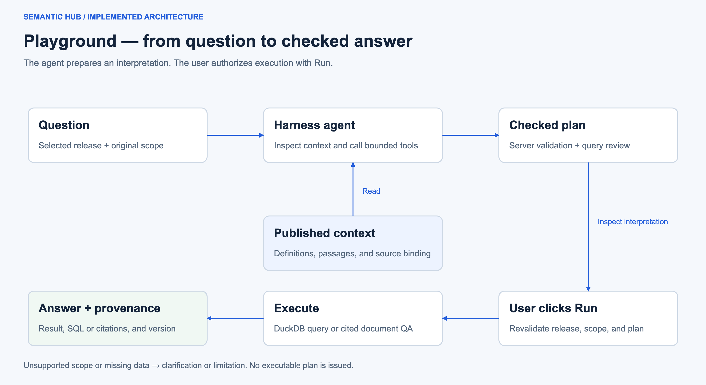

# Playground agent architecture

The Playground uses the official **DeepSeek Harness** framework.
The query model comes from Model configuration. GPT-4o was used in the historical acceptance checks.
These are separate choices: Harness coordinates the work; the model selects tools and proposes a typed plan.
The integration pins `deepseek-harness-sdk` and `deepseek-harness-runtime-bin` to `0.1.5rc1`.
The framework is a developer preview. Upgrade both packages together and rerun acceptance tests.



Download the [editable draw.io](diagrams/playground-agent-architecture.drawio), [SVG](diagrams/playground-agent-architecture.svg), or [PNG](diagrams/playground-agent-architecture.png).
See the [overall technical architecture](semantic-hub-technical-architecture.md) for service and storage boundaries.
The diagram was refreshed against the implementation on 21 October 2026.
The diagram describes the current implementation, including the explicit Run gate.
It does not describe a fleet of independently deployed specialist agents.

```text
Original question + published version
                 |
       DeepSeek Harness coordinator <--- semantic skills
                 |
       bounded semantic tool bridge ---> release-scoped audit memory
                 |
       source coverage + server validation
                 |
        +--------+--------------------+
        |                             |
 No data / clarify                Checked plan
                                      |
                               User clicks Run
                                      |
                           Revalidate release and scope
                                      |
                        DuckDB / cited document answer
                                      |
                            Result + provenance
```

## Modules and responsibilities

| Module | Current implementation |
|---|---|
| Harness | `shared/helios_core/demo/agent/harness.py` starts the official SDK subprocess with `sdk-minimal`. |
| Model adapter | Official `llm-pi-ai` plugin routes to the existing OpenAI-compatible query configuration. GPT-4o was tested. |
| Skills | `agent/skills/query.md` specifies scope preservation, tool order, clarification, and receipt-only output. |
| Tool plugin | `agent/plugin.mjs` registers tools through the official Cordis tool registry. |
| Tool bridge | A token-protected loopback HTTP endpoint connects the subprocess to bounded Python operations. |
| Tools | `agent/tools.py` implements inspection, evidence retrieval, coverage checks, and typed-plan preparation. |
| Scope enforcement | `agent/scope.py` checks original question periods against actual source rows. |
| Memory | `agent/memory.py` records release-scoped turn summaries in SQLite. Harness also retains native session events. |
| Execution | The existing Playground validates the stored plan again before bounded DuckDB execution or document QA. |
| UI | Agent checks display the framework, configured model, tool results, requested period, and observed coverage. |

This increment uses explicit query instructions as a skill module.
It does not install a general-purpose skill marketplace or an autonomous skill discovery system.
Memory currently provides an audit trail, not cross-question conversational recall.
Each question starts an independent Harness session.
Previous answers never become authoritative data for a later question.

## Tools and safeguards

1. `inspect_model` reads reviewed metrics, qualified fields, and relationships.
2. `inspect_coverage` queries actual date bounds or exact cohort pairs.
3. `read_document_evidence` reads bounded passages from the selected published release.
4. `prepare_query` submits one metric and typed dimensions and filters.
5. `prepare_document` prepares citation-checked answering for the original question.
6. `request_clarification` records unsupported or ambiguous intent.

The server limits each turn to twelve tool attempts and 120 seconds of inference.
Runtime initialization has a separate 30-second timeout.
The SDK profile disables shell tools. The agent has no general filesystem, web, publication, or arbitrary SQL tool.
Tool schemas enumerate published metric names and qualified field names.
The model cannot approve a draft or publish a version.

The model returns a server receipt identifier.
The UI consumes the checked receipt, not arbitrary model prose.
One unambiguous receipt remains usable if the model adds surrounding prose.
Multiple receipts require an explicit final choice.
Runtime failures appear as **Agent unavailable** and cannot count as a successful refusal test.

Model inspection includes fact-table fields and bounded observed categories.
This prevents a reporting timezone from becoming an invented region filter.
An independent AI review checks each proposed metric query against the original question.
Rejected plans are discarded before the UI can run them.
This review supplements deterministic checks; it does not guarantee every interpretation is correct.

## What happens to the problematic pharma question

Question: `What is the US market percentage for new medicines launched from 1999 to 2020?`

The agent selects the reviewed new-medicine metric and inspects `industry_observations`.
The source contains the cohort pair `(2020, 2024)`.
It does not contain `(1999, 2020)`.
The server returns **No matching data** without an executable plan.
The response can show available coverage, but it cannot substitute the 74.1% value.

Question: `What is the US share of sales for new medicines launched during 2020–2024?`

The server checks the exact pair and adds both period filters itself.
The user then runs the checked plan.
The fixture returns **74.1%**.
Launch cohort, latest-sales year, and report year remain different concepts.

Single-year DATE questions receive server-generated year filters.
Explicit intervals outside complete snapshot coverage do not return a partial total.
Relative periods require explicit dates.
Multiple date axes require an unambiguous requested field.
Cohort intervals and typed DATE fields are supported; arbitrary fiscal calendars and free-text period fields remain clarification cases.

Combined questions can assign separate time scopes to metric and document clauses.
Both clauses must be exact, non-overlapping excerpts of the original question.
The server rejects omitted clauses. Final document claims still undergo citation and original-question checks.
Metric semantics beyond these deterministic checks still depend on model interpretation and human inspection.
This is not a proof of arbitrary natural-language correctness.

## Storage and local deployment

Agent state lives under:

```text
<state-dir>/playground-agent/<source-id>/<context-sha256>/
  turns.sqlite             checked turn summaries; latest 500 records
  runtime/sessions/        official Harness event logs
```

Harness session logs have separate retention from the bounded summary table.
Operators must define retention before production deployment.
The temporary bridge token and provider credential are passed through subprocess environment variables.
They are not embedded in plugin configuration files or displayed in the UI.
The existing model configuration still controls drafting, querying, and embeddings separately.
No new DeepSeek model credential is needed for the tested GPT-4o configuration.

Install the pinned dependencies using `apps/helios/demo-requirements.txt`.
The official runtime distribution supplies its executable; a separately managed Node service is not required.
The local demo remains at `http://localhost:8084/demo`.
Existing releases and their review state remain unchanged.

## External agent boundary

The [consumer API and MCP](semantic-hub-consumer-api.md) now expose published context independently of this Harness.
Advanced agents call those contracts directly. They do not nest the Playground interpreter.
The [CAI workflow](semantic-hub-agent-studio-workflow.md) is prepared for that integration.

## Verification

- [Pharma Harness acceptance](playground-harness-verification.json): live GPT-4o through the official SDK.
- [Finance and power Harness acceptance](customer-query-harness-verification.json): current acceptance status for the forty customer cases.
- [Browser verification](playground-harness-browser-verification.json): desktop/mobile no-data state and valid 74.1% execution.
- `apps/helios/tests/test_playground_agent.py`: deterministic scope guards, tool boundaries, budget, and audit isolation.
- `apps/helios/workbench/check_playground_harness.py`: repeatable isolated live pharma acceptance.

Current live results: 7/7 pharma cases and 38/40 finance/power cases passed.
Two power questions confuse Singapore reporting dates with a region filter.
This remains a lightweight validation tool, not general NL-to-SQL acceptance.

The earlier [customer query report](customer-query-verification.json) describes the previous planner.
It does not establish acceptance of this Harness implementation.
Test reports describe local samples, not enterprise source connectors or production authorization.

## References and design lineage

The integration uses the [official DeepSeek Harness repository](https://github.com/deepseek-ai/deepseek-harness)
and its [Python SDK](https://github.com/deepseek-ai/deepseek-harness/blob/master/python/sdk/README.md).
The installed release is pinned; repository master may document newer interfaces.
The [framework architecture](https://github.com/deepseek-ai/deepseek-harness/blob/master/docs/architecture.md)
explains the plugin composition used here.

The sibling UOB observability workflow informed the original-question checks, bounded tools, and evidence trace.
Helios does not import that application's operational investigation actions.
Enterprise identity, authorization, durable job recovery, conversation recall, live Trino execution, and external-agent routing remain separate milestones.
