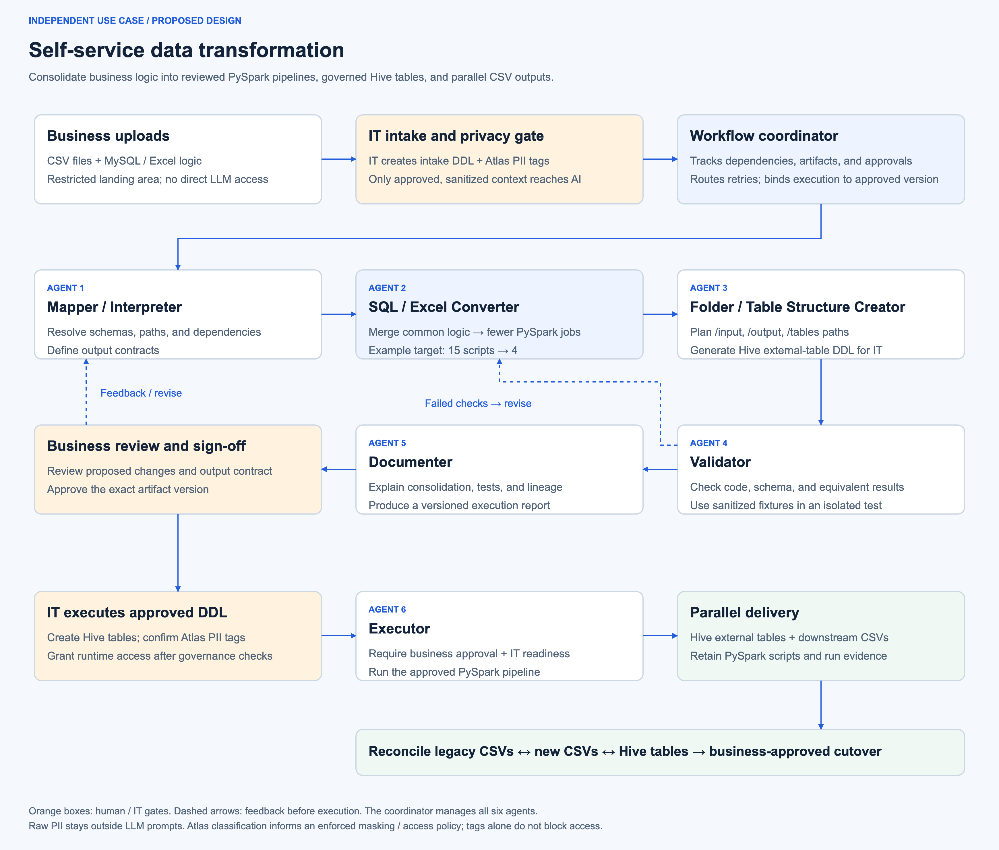

# Self-service data transformation: agent workflow proposal

This is an independent use-case design, not a Semantic Hub feature or implementation claim.
The whiteboard supplied by the business team informs the coordinated workflow.
The design reuses general patterns from Semantic Hub: bounded tools, reviewed artifacts, explicit execution approval, and provenance.



[Editable draw.io](agent-workflow.drawio) · [SVG](agent-workflow.svg) · [PNG](agent-workflow.png)

Start with the [technical walkthrough](technical-walkthrough.md) for an example-led explanation of the diagram.

## Purpose

Business users upload CSV files and MySQL scripts or Excel transformation logic.
The workflow produces PySpark scripts, Hive external-table DDL, and downstream CSV outputs.
It consolidates shared logic across scripts instead of translating each script independently.
Reducing 15 scripts to 4 is an illustrative target, not a guaranteed reduction.
Correctness, business ownership, and dependencies determine the final grouping.

## Six agents and a coordinator

The coordinator manages a durable workflow state and versioned artifact manifest.
It routes work, limits retries, records decisions, and enforces prerequisites.
It is a control component, not a seventh transformation agent.

| Agent | Responsibility | Reviewable artifact |
| --- | --- | --- |
| Mapper / Interpreter | Resolve source fields, target schemas, folder paths, dependencies, and output ownership. Flag ambiguous rules. | Source-to-target mapping and output contract |
| SQL / Excel Converter | Decompose logic, identify repeated transformations, and consolidate compatible steps into PySpark jobs. | PySpark scripts, dependency graph, and original-to-new script mapping |
| Folder / Table Structure Creator | Generate consistent path plans and Hive external-table DDL. Use approved location and naming rules. | Folder manifest and DDL package for IT |
| Validator | Check syntax, types, dependencies, schemas, and behavioral equivalence using approved test fixtures. | Test results, reconciliation results, and unresolved issues |
| Documenter | Explain transformations, consolidation decisions, lineage, tests, expected outputs, and planned execution. | Human-readable execution report |
| Executor | Verify business approval, IT readiness, and artifact hashes. Run only the approved pipeline. | Run logs, output manifests, table results, and CSV files |

The Mapper runs first so conversion uses an agreed output contract.
Validation failures return work to the Converter or Mapper.
Business feedback returns the plan for revision before execution.
Any executable artifact change invalidates prior approval and requires validation and sign-off again.
Unresolved conversion ambiguity blocks execution rather than inventing a business rule.

## Governance gates

1. Land uploads in a restricted staging area without automatic LLM ingestion.
2. Use non-LLM inspection and IT review to inventory schemas and identify sensitive fields or literals.
3. Have IT execute intake DDL and establish Apache Atlas column classifications before releasing context to the agents.
4. Apply an enforced access and masking policy to the LLM-facing context.
5. Provide agents only approved schemas, sanitized scripts, and synthetic or approved de-identified test fixtures.
6. Collect business sign-off on the validated execution package.
7. Have IT execute the generated output DDL and confirm output-column Atlas classifications and runtime permissions.
8. Permit the Executor to run only when both business approval and IT readiness match the approved artifact version.

The intake gate breaks the dependency between AI-generated output DDL and classification before AI access.
IT can create intake definitions from reviewed schemas without sending uploaded data to an LLM.
Output-table DDL is a separate package generated later and executed only by IT.
Neither business users nor agents receive Hive CREATE or ALTER privileges.
The Executor receives only the data access needed for the approved run.

Atlas tags identify classifications; tags alone do not enforce LLM access restrictions.
The integration must enforce masking and access checks before constructing prompts or returning tool results.
SQL literals, spreadsheet cells, filenames, reports, and error messages also need sensitive-content checks.
Real data processing stays in the approved execution environment; raw rows do not enter LLM prompts or agent logs.
Classification changes invalidate the previous readiness decision.

## Consolidation contract

The Converter analyzes the full dependency graph before proposing job boundaries.
It can merge repeated reads, filters, joins, lookups, and intermediate calculations when their semantics match.
It must preserve required output datasets, ordering requirements, and downstream interfaces.
Different schedules, access boundaries, or business meanings may require separate jobs.

The report maps every original script and output to its replacement job.
Validation checks null handling, decimals, date semantics, joins, duplicate behavior, and aggregation rules.
Excel formulas require explicit handling of lookup behavior, errors, cell dependencies, and rounding.
Macros or external workbook dependencies remain unresolved until their behavior is specified and supported.
Validation includes controlled execution of generated code without production write privileges.
A smaller script count is accepted only when the required behavior and outputs remain correct.

## Example folder plan

```text
/data/projects/self-service/use-case-1/
├── input/                 # Restricted business uploads
├── scripts/               # Approved PySpark jobs
├── ddl/                   # Hive DDL; executed by IT
├── tables/                # External-table data locations
├── output/
│   └── <run-id>/          # Parallel downstream CSV outputs
└── reports/
    └── <run-id>/          # Validation, approvals, lineage, reconciliation
```

The Structure Creator proposes paths and a creation manifest.
The authorized runtime provisions approved folders; IT controls table definitions and their storage-location permissions.
The deployed filesystem or object-store URI scheme must be agreed during implementation.

## Parallel operation and cutover

1. Continue the existing process and retain its CSV outputs as a comparison baseline.
2. Run the approved new pipeline against an equivalent input window.
3. Produce both Hive table data and downstream CSV outputs from the same approved transformations.
4. Compare legacy CSVs, new CSVs, and table results using agreed keys, counts, totals, and tolerances.
5. Investigate discrepancies and repeat validation before approving changed artifacts.
6. Cut over only after business acceptance across the agreed reconciliation period.

Each run records the input identity, code version, approvals, table destinations, and CSV locations.
The design should stage outputs and publish a completion manifest only after both delivery paths succeed.
A failed or partial run must remain visible and must not count as successful reconciliation.
Retry and recovery behavior must prevent duplicate writes.
Business and IT teams must agree on the parallel-run duration, tolerances, retention, and rollback procedure.

## Design decisions still required

- Supported MySQL dialect features and Excel input forms: formulas, workbooks, macros, or exported scripts.
- Spark runtime, storage backend, Hive catalog, and enforcement integration for Atlas classifications.
- Approved LLM endpoint and permitted prompt content.
- Existing business baseline, reconciliation tolerances, and cutover owner.

## Regenerate the diagram

```sh
python docs/self-service-data-transformation/render_diagram.py
python docs/self-service-data-transformation/render_diagram.py --chromium /path/to/chromium
```

The local renderer reuses the repository's drawing utility only.
It has no dependency on Semantic Hub application services or runtime state.
