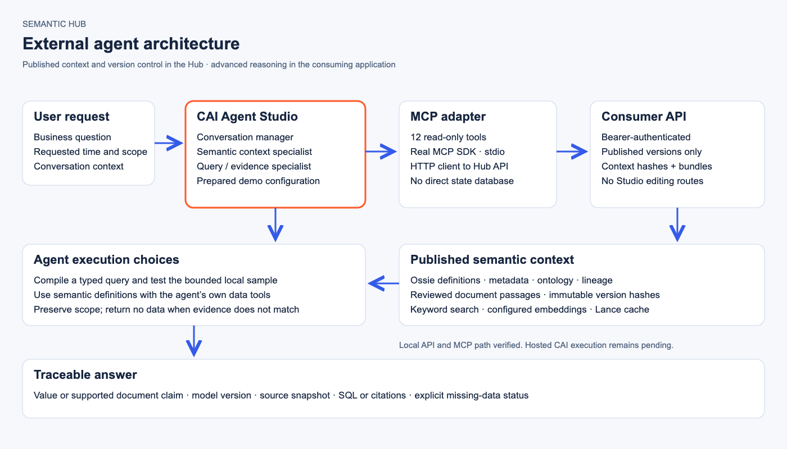

# Semantic Hub API and MCP consumer contract

The Hub publishes governed semantic context for external agents.
Studio owns drafting, review, publication, and version history.
The Playground is a lightweight validation surface.
An external NL-to-SQL agent owns interpretation, planning, and its execution environment.



[Editable architecture SVG](diagrams/semantic-hub-external-agent.svg)

```text
CAI Agent Studio or another agent
                |
        Semantic Hub MCP adapter
                |
       Read-only consumer HTTP API
                |
   Published models, metadata, ontology
   Versioned lineage and document evidence
                |
        Bounded semantic context
                |
   Typed compilation / local sample query
   or the external agent's own data tools
```

## Start the API

Install `apps/helios/demo-requirements.txt` in the existing demo environment.
Use the same state directory as Studio.
Run the local API without a consumer token:

```bash
python start_semantic_hub_api.py \
  --state-dir /path/to/semantic-hub-state \
  --local-no-auth --host 127.0.0.1 --port 8096
```

`--local-no-auth` only accepts a loopback host.
CAI `cdsw_v2_key` authentication is planned for AMP deployment.
The current application does not validate CAI keys.

For inherited OpenAI embedding configuration, add `--model-token-file ~/tokens/openai`.
Alternatively provide the credential environment variable selected in Model configuration.
No generation model runs during consumer search, resolution, compilation, or sample execution.
Embedding search invokes the configured embedding provider when vectors are not cached.

The prepared local instance uses `http://127.0.0.1:8096` because port 8086 was occupied.
The previous local consumer token has been removed.
The original Studio remains on port 8084.

### Swagger UI

Open [local Swagger UI](http://127.0.0.1:8096/docs).
The schema loads automatically in local mode. No consumer token is required.
Expand an endpoint and select **Try it out**.
The documentation uses locally vendored Swagger UI assets.
`/api/semantic-hub/v1/docs` also redirects to this page.

Deploy this dedicated API process for remote consumers.
It mounts no Studio editing, upload, review, activation, or publication routes.
Use a reachable HTTPS deployment for CAI.
CAI cannot reach a laptop's `localhost` directly.
Local mode exposes all published models in this workspace to local clients.
Per-user grants, enterprise identity, and live data-engine authorization require a separate production integration.

## Endpoints

Local mode requires no token. Hosted bearer mode remains available through `--api-token-file`; it is not CAI authentication.
The API root is `/api/semantic-hub/v1`.

| Endpoint | Purpose |
|---|---|
| `GET /capabilities` | Actual search and execution capabilities, limits, and authorization scope |
| `GET /openapi.json` | API schema |
| `GET /models?q=&offset=&limit=` | Published inventory; no draft definitions |
| `GET /models/{model_id}` | Model summary, safe source information, and published versions |
| `GET /models/{model_id}/versions` | Published version names and hashes |
| `GET /models/{model_id}/versions/{version}` | Definitions, Ossie, metadata, and ontology |
| `GET /models/{model_id}/versions/{version}/graph` | Declared and SQL-derived lineage |
| `GET /models/{model_id}/versions/{version}/documents` | Linked document passages frozen in that publication |
| `POST /search` | Keyword or configured embedding search |
| `POST /resolve` | Bounded semantic context and expiring `bundle_id` |
| `POST /coverage` | Actual source temporal coverage and metric scope |
| `POST /compile` | Validate a typed request and compile local DuckDB SQL |
| `POST /query` | Execute a bounded local sample query |

Version detail, graph, and document reads accept `context_sha256` as a query parameter.
Provide it after discovery to detect mismatched version bindings.
Resolve, coverage, compile, and query require `model_id`, `version`, and `context_sha256`.
Compilation and execution also require the returned `bundle_id`.
Bundles expire after 300 seconds and are bound to the consumer, source session, and release.
Restarting the API invalidates existing bundles.

## Search and retrieval

Users do not need to enter a model name for discovery.
An agent can search across all published models available to its consumer token.
An optional `model_id` narrows discovery when the user or application already knows the model.
The agent selects a model and pins its version and context hash before resolving or executing a query.
If several models have plausible but different meanings, the agent asks the user to select the intended meaning.
Cross-model discovery does not authorize an automatic cross-model SQL join.

Keyword search uses the existing semantic index.
Descriptions, synonyms, business metadata, fields, and relationships inform retrieval.
Embedding search vectorizes published semantic records with the configured embedding model.
Vectors are cached in `consumer-search.lance`, isolated by provider fingerprint and dimension.
The server ranks only records in the selected published versions.
A disabled or unavailable embedding provider returns an explicit error.
The server never labels a keyword fallback as an embedding result.

```json
{"query":"new medicine sales share","model_id":"pharma_intelligence","version":"v1.0","mode":"keyword","limit":5}
```

Use `mode: "embedding"` for vector ranking.
Search results are candidates, not proof that a metric answers a question.
Read the definition and pin its hash before planning.
Metadata and ontology are also available in version details.
Related entities do not authorize a join or establish factual support.

## Typed queries

1. Discover and select a published model.
2. Read its version details and retain the context hash.
3. Check the metric's population, geography, time rule, unit, and calculation.
4. Inspect actual temporal coverage with the original question.
5. Resolve the metric and every required field.
6. Compile the typed request using the returned bundle.
7. Execute locally only when a sample query meets the demo's purpose.
8. Return the value with its scope, version, and evidence.

Resolve automatically includes fields needed for mandatory time filters.
Explicit filter and grouping fields still belong in `required_fields`.
Query filters use `{ "field": "table.field", "op": "=", "value": "value" }`.
Only one published metric, three dimensions, twenty filters, and one hundred result rows are supported.
The service accepts no arbitrary SQL.
The local compiler output is DuckDB SQL; it is not verified against a live Trino or Impala deployment.

A fixed USA metric cannot become a Korea metric by adding a conflicting filter.
A missing cohort returns `no_data`, not a nearby period's value.
An empty result or all-null metric result is missing evidence, not zero.
A zero aggregate remains a valid zero when the metric computes it.
The backend validates typed contracts and explicit scope constraints.
The calling agent must still verify natural-language meaning; this API is not an autonomous NL-to-SQL correctness guarantee.

## MCP and CAI

The [MCP package](../apps/semantic-hub-mcp/README.md) exposes twelve read-only tools over stdio.
It calls the HTTP API and never opens the state database directly.
The existing legacy Helios MCP application targets a different production artifact store.
This adapter serves the current versioned Semantic Hub workspace.

Use the [English CAI workflow](semantic-hub-agent-studio-workflow.md)
or [Chinese CAI workflow](semantic-hub-agent-studio-workflow.zh-CN.md).
Both contain agent roles, paste-ready instructions, tool assignments, and demo questions.
Hosted CAI deployment remains unverified.

## Verification

Latest consumer documentation regressions: 11 API tests and 12 MCP tests passed.
Swagger browser verification confirmed token rejection, authenticated schema loading, and a successful **Try it out** request.
See [Swagger verification](semantic-hub-swagger-verification.json).
Run these suites in separate processes because the legacy Helios `mcp` package shares the SDK package name.

- `apps/helios/tests/test_semantic_hub_consumer.py`: authenticated publication boundaries, version and bundle checks, scope filters, local execution, and Lance embedding caching.
- `apps/semantic-hub-mcp/tests/`: schemas, HTTP forwarding, error handling, and real SDK stdio integration.
- [Live MCP report](semantic-hub-mcp-verification.json): actual SDK client → MCP subprocess → local HTTP API → published pharma v1.0.

The consumer path does not depend on the Playground interpretation acceptance rate.
The separate Harness report still records known natural-language limitations in the lightweight Playground.
