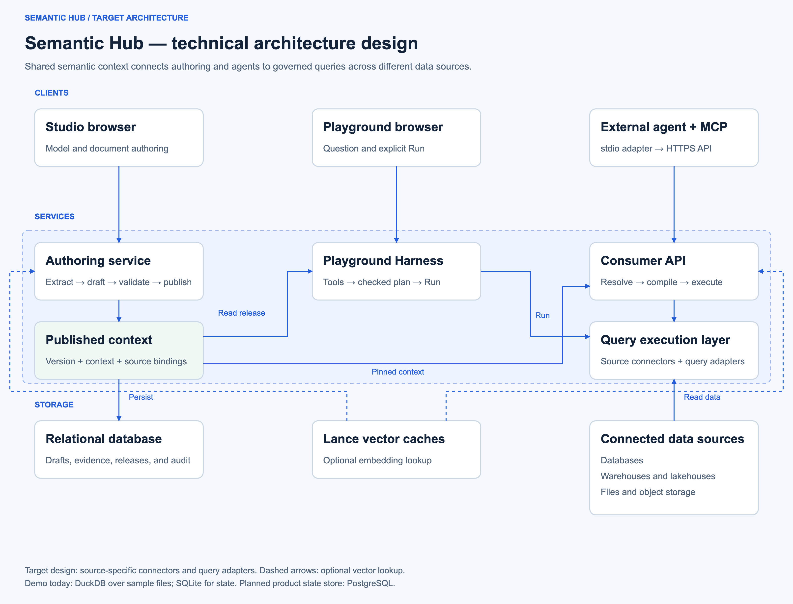
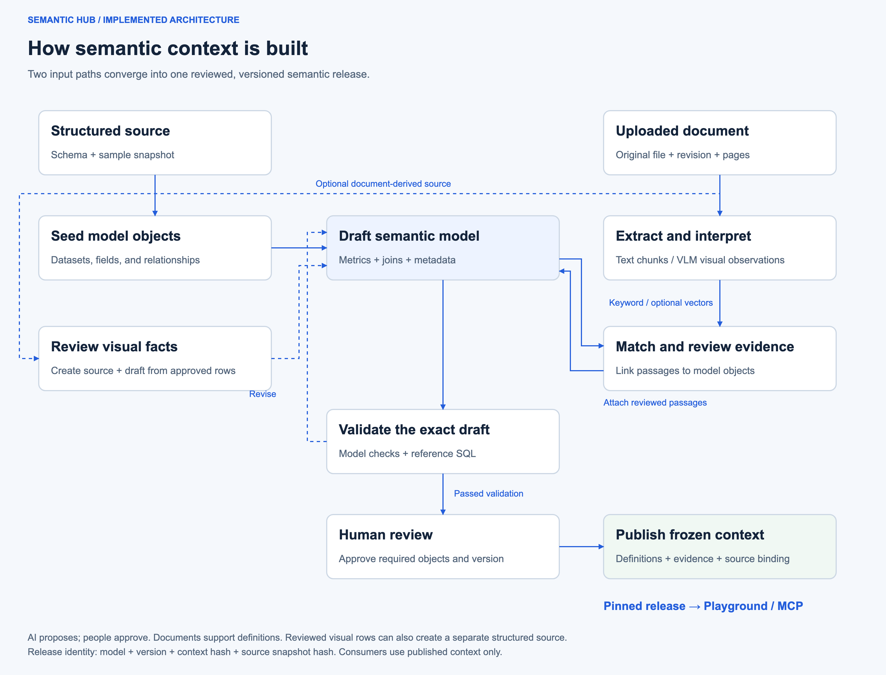

# Semantic Hub technical architecture

Architecture design updated on 22 October 2026.
The main diagram shows the target design. The implementation details below describe the current Semantic Hub AMP code.



[Editable draw.io](diagrams/semantic-hub-technical-architecture.drawio) · [SVG](diagrams/semantic-hub-technical-architecture.svg) · [PNG](diagrams/semantic-hub-technical-architecture.png)

The [user overview](diagrams/semantic-hub-overview.drawio) explains authoring, review, publication, and consumption.
The technical view separates semantic services, persistent application state, and connected business data sources.
The query execution layer uses source-specific connectors and query adapters for databases, warehouses, lakehouses, and files.
These connections are target architecture capabilities; the current demo uses DuckDB over local source-pack files.
The relational database stores application state. The demo uses SQLite; the planned product store is PostgreSQL.
This diagram change does not implement remote connectors or migrate persistent state.
The [Playground view](playground-agent-architecture.md) expands the internal interpretation and explicit Run path.

## Building semantic context



[Editable draw.io](diagrams/semantic-context-build-flow.drawio) · [SVG](diagrams/semantic-context-build-flow.svg) · [PNG](diagrams/semantic-context-build-flow.png)

1. Seed datasets, fields, and relationships from a structured source.
2. Draft metrics, joins, and business metadata.
3. Extract document text or interpret pages with the configured vision model.
4. Match passages to model objects, review the matches, and attach evidence.
5. Validate the exact draft, including metric reference SQL checks.
6. Approve required review items and review the version.
7. Publish definitions, linked passages, and source bindings as immutable context.

Approved visual observations can also create a structured source and a new draft.
This optional path requires explicit review of the extracted rows.
Failed validation returns the draft for revision.
Published releases supply both Playground and MCP consumers.

## Runtime and API boundaries

The CAI AMP starts one FastAPI Application with one shared `DemoHub` and state root.
Consumer API and Swagger routes are registered before the mounted authoring application.
Studio, supporting materials, and Playground use that same workspace.
The launcher runs one Uvicorn worker behind CAI Application ingress.

External Agent Studio clients start `semantic-hub-mcp` as a separate stdio subprocess.
The adapter calls `/api/semantic-hub/v1` over HTTPS and forwards the supplied CAI API v2 key.
It does not open workspace databases or host an HTTP MCP endpoint.
The consumer tools cannot edit, approve, or publish models.

```text
Agent Studio -> MCP stdio subprocess -> CAI ingress -> consumer HTTP API
Browser ----------------------------> CAI ingress -> authoring / Playground
                                                       |
                                                shared Hub runtime
```

CAI ingress authenticates Application access.
The current consumer API exposes workspace-wide published models; it does not enforce per-model grants.
The broader Helios React/API/Streamable-HTTP MCP stack is a separate implementation surface.
Its Atlas, Impala, delegated identity, and Ranger paths are not part of this AMP's sample-query path.

## Service modules

| Module | Responsibility |
| --- | --- |
| [Application composition](../cai_integration/application.py) | Combine consumer routes, Swagger, and the authoring application |
| [DemoHub](../apps/helios/console/demo_hub.py) | Share source runtimes, connection catalog, and state root |
| [Materials](../shared/helios_core/demo/materials.py) | Retain originals, revisions, extracted chunks, analysis, matching, and reviewed links |
| [Visual documents](../shared/helios_core/demo/visual_documents.py) | Interpret selected source pages with the configured draft/VLM provider |
| [Document facts](../shared/helios_core/demo/document_facts.py) | Create a source and draft from explicitly reviewed visual observations |
| [Context workspace](../shared/helios_core/demo/context.py) | Save drafts, validate, review, version, and publish immutable context |
| [Model configuration](../shared/helios_core/demo/llm_settings.py) | Separate draft, query, and embedding profiles; resolve credentials |
| [Playground](../shared/helios_core/demo/playground.py) | Store checked plans and revalidate bindings before execution |
| [Harness](../shared/helios_core/demo/agent/harness.py) | Run one bounded tool-using query agent through a local HTTP bridge |
| [Consumer service](../shared/helios_core/demo/consumer.py) | Discover releases, search definitions, resolve bundles, inspect coverage, compile, and query samples |
| [Retrieval service](../shared/helios_core/retrieval/service.py) | Bind bounded context bundles to caller scope and release; enforce expiry |
| [Compiler](../shared/helios_core/compiler) | Compile typed semantic requests from reviewed definitions |
| [Local engine](../shared/helios_core/demo/local.py) | Execute bounded SELECT queries in DuckDB over source-pack bytes |

Document-derived observations create a draft, not an automatically published model.
Document links provide business evidence; they do not become SQL joins or certify computed sample amounts.

## Persistent stores

| Store | Contents and use |
| --- | --- |
| Source-specific `context.sqlite` | Drafts, validation, review decisions, releases, publication records, and attached evidence |
| `supporting-materials.sqlite` | Original document bytes, revisions, extracted text/VLM chunks, analysis, reviewed links, and usage |
| `connections.sqlite` | Source and connection profiles |
| `llm-settings.sqlite` | Provider configuration and encrypted saved model credentials; encryption key remains in local state |
| `supporting-material-vectors.lancedb` | Document-chunk and model-object embeddings used for evidence matching |
| `consumer-search.lance` | Published metric, dataset, and field embeddings used by MCP semantic search |
| Source-pack files and `document-models/` | Immutable local source data, Ossie models, metadata, and reviewed document-derived sources |
| `playground-agent/.../turns.sqlite` and native Harness sessions | Release-scoped audit summaries and runtime event logs |

LanceDB persists local Lance tables, separated by provider fingerprint and vector dimension.
New embeddings use these tables; legacy SQLite vector rows can migrate into Lance.
The current wrapper accepts local filesystem paths, not configured remote object-store URIs.
SQLite and source files remain separate from DuckDB, which performs validation and sample execution.

## Search and document retrieval

Keyword search is the default for both document-to-model matching and MCP semantic discovery.
Embedding mode is optional and requires a configured provider.
The backend computes cosine similarity in application code using vectors cached in Lance.
It ranks the bounded candidate set rather than using a LanceDB approximate-nearest-neighbor index.

MCP `search_semantics` searches published metric, dataset, and field definitions.
It does not vector-search the published document passages.
`get_published_documents` returns the linked passages frozen in the selected release.
The calling agent selects supporting passages and cites their returned revision and page.

## Publication and query contracts

A publication freezes the reviewed definition, Ossie model, metadata, ontology artifacts, and linked document passages.
The context hash and source snapshot hash preserve the selected meaning and data binding.
External agents discover and pin a release before resolving a query.
Numeric execution requires a valid expiring `bundle_id`, one metric, supported fields, and typed filters.

For a scalar finance total, the resolver preserves an empty additional-field list.
It includes the selected metric's dependencies without adding unrelated fields through keyword expansion.
Server-required temporal fields remain included.
Different reference-SQL tables can provide an independent reconciliation rather than a competing metric definition.

The consumer API compiles DuckDB SQL and optionally executes local sample data.
It does not execute arbitrary SQL or route this API's sample query to a live enterprise warehouse.
Agents retain responsibility for natural-language interpretation and business scope.
The Playground instead uses its internal Harness and requires the browser's explicit Run action.
External MCP consumers do not invoke that Harness or inherit its browser Run gate.

## Rebuild the diagrams

1. Run the generator from the repository root.
2. Supply an installed Chromium executable when PNG exports are required.
3. Inspect the generated previews before sharing them.

```sh
python apps/helios/workbench/architecture_diagrams.py --all

python apps/helios/workbench/architecture_diagrams.py --all \
  --chromium /path/to/chromium
```

The generator writes matching draw.io and SVG files for all three views.
Chromium exports PNGs at twice the diagram's logical resolution and checks each text label against its assigned width.
Each draw.io file contains separate editable shapes, labels, and connectors.
The existing `render_hub_overview.py` command remains available for the overview alone.

Enterprise PostgreSQL, remote object storage, durable jobs, and Hub-to-Atlas synchronization remain proposed extensions.
See [storage and Atlas boundaries](semantic-hub-storage-and-atlas.md) for that separate design.
